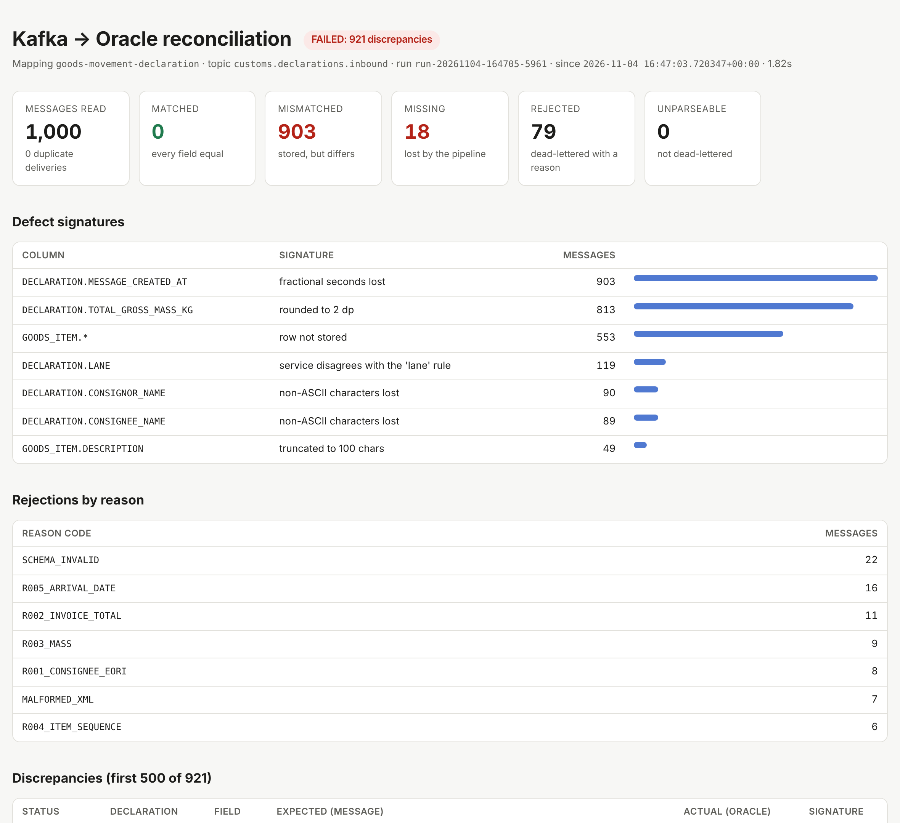
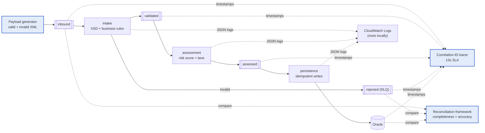
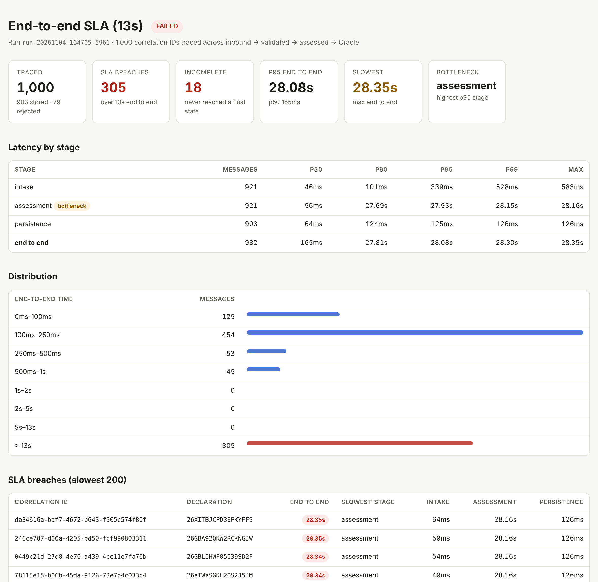

# customs-event-test-harness

[](https://gitlab.com/sd00154/customs-event-test-harness/-/pipelines)
[](https://github.com/Sumil5/customs-event-test-harness/actions/workflows/ci.yml)

Test automation for an **event-driven trade and customs pipeline**: Kafka-driven services that validate, risk-assess and store XML goods-movement declarations in Oracle. The harness generates the traffic, proves every message landed in Oracle **accurately, field by field**, and traces every message **end to end against a 13-second SLA**.

> This is a personal re-creation, built from scratch, of the testing approach I used as the sole tester on a UK government post-Brexit trade and customs programme (2023–2025). Everything here is synthetic and was built independently: the XML schema, the services, the business rules and the data. It contains no client code, schemas, data or internal details.



## What's in the box



| Component | What it does | Code |
|---|---|---|
| **XML payload generator** | Builds realistic declarations from 18 named scenarios (edge cases and deliberately invalid messages), validates them against the XSD and publishes tagged runs to Kafka. No more hand-built test messages. | [`generator/`](src/customs_harness/generator) |
| **Reconciliation framework** | Reads a bounded slice of a topic, parses each XML message, maps it to Oracle columns through a YAML mapping (XPath, typed transforms, code lookups, independently derived business rules) and compares **field by field**. Every message must be stored accurately or dead-lettered with a reason. Mismatches are grouped into *defect signatures* such as "rounded to 2 dp" or "truncated to 100 chars". | [`reconciliation/`](src/customs_harness/reconciliation) · [mapping](config/mappings/goods_movement_declaration.yaml) |
| **Correlation-ID tracer** | Follows each message across every topic and into Oracle by correlation ID, computes per-stage and end-to-end latency, checks the **13-second SLA**, finds the bottleneck stage, and works out where lost messages stopped. | [`tracing/`](src/customs_harness/tracing) |
| **CloudWatch investigation** | The services ship structured JSON logs to CloudWatch Logs (the [moto](https://github.com/getmoto/moto) emulator locally). `harness timeline <correlation-id>` merges the Kafka hops, the Oracle commit and the log lines into one timeline. | [`cloudwatch.py`](src/customs_harness/tracing/cloudwatch.py) |
| **System under test** | Three small Python services with at-least-once delivery, a dead-letter topic, idempotent Oracle writes and **switchable defects** for proving the harness works. | [`services/`](services/customs_services) |
| **Docker + CI/CD** | The whole stack and the harness run in containers. The GitLab pipeline runs lint, unit, end-to-end and fault-injection stages and publishes reports to Pages. GitHub Actions mirrors it. | [`Dockerfile`](Dockerfile) · [`.gitlab-ci.yml`](.gitlab-ci.yml) |

Stack: Python 3.13 · Apache Kafka 4.3 (KRaft) · Oracle AI Database 26ai Free · confluent-kafka · python-oracledb (thin mode) · lxml · pytest · Docker Compose · GitLab CI/CD · uv · ruff. Every image is multi-arch, so it all runs natively on Apple Silicon.

## Quick start

You need Docker (OrbStack or Docker Desktop), `uv` and `make`. On an Apple Silicon Mac, see [docs/mac-setup.md](docs/mac-setup.md).

```bash
git clone https://gitlab.com/sd00154/customs-event-test-harness.git
cd customs-event-test-harness
make install   # Python 3.13 virtualenv via uv
make up        # Kafka, Oracle, moto + three services; about 30s once images are pulled
make demo      # publish 2,000 messages, then reconcile and trace them
```

`make demo` prints both verdicts and writes HTML, JSON and CSV reports to `reports/<run-id>/`:

```text
2,000/2,000 accounted for after 1.4s
Reconciliation of 2,000 messages from customs.declarations.inbound in 2.9s: PASSED
SLA 13s over 2,000 traced messages: PASSED  (0 breaches, 0 incomplete)
│ end to end │ 2,000 │ p50 140ms │ p95 439ms │ p99 858ms │ max 923ms │
```

The first run after `make up` includes a one-off database warm-up. Oracle allocates each table's storage on its first insert and its caches start cold, so *persistence* shows as the bottleneck. From the second run, end-to-end p95 is about 200 ms.

```bash
open reports/$(cat reports/LATEST)/reconciliation.html
open reports/$(cat reports/LATEST)/sla.html
```

## Proving the harness actually catches defects

A reconciliation that always says PASSED is worse than having none. The services can be restarted with known defects switched on:

```bash
make demo-faults   # run against faulty services, then restore them
make faults-on && make test-faults   # the assertion-based version that CI runs
```

| Injected defect (service) | Real-world cause it mimics | What the harness reports |
|---|---|---|
| `rounding` (persistence) | `NUMBER(14,2)` column for a 3-dp value | `TOTAL_GROSS_MASS_KG`: *rounded to 2 dp* |
| `truncate_description` | Undersized column or mapping | `GOODS_ITEM.DESCRIPTION`: *truncated to 100 chars* |
| `ascii_names` | Character-set or NLS mismatch | Party names: *non-ASCII characters lost* |
| `drop_millis` | `datetime` bound as `DATE` | `MESSAGE_CREATED_AT`: *fractional seconds lost* |
| `skip_last_item` | Off-by-one in a child loop | `GOODS_ITEM[n].*`: *row not stored* |
| `drop=0.02` | Offset committed before the write | **MISSING** messages; the tracer reports *stopped after assessed: look at the persistence service* |
| `lane_boundary` (assessment) | `>` instead of `>=` | `LANE`: *service disagrees with the 'lane' rule*, only on score-40 boundary cases |
| `delay` (assessment) | Slow downstream call | **SLA breaches**, bottleneck *assessment* (head-of-line blocking) |

Fault selection is a deterministic hash of the declaration reference, so [`test_injected_faults.py`](tests/e2e/test_injected_faults.py) can predict exactly which messages each fault will hit. It then asserts that the reports name those messages and no others.



## Tests

| Suite | Count | Needs | Time | Command |
|---|---|---|---|---|
| Unit and contract | 127 | nothing | ~2 s | `make test` |
| End to end | 26 | `make up` | ~35 s | `make e2e` or `make e2e-docker` |
| Fault injection | 9 | `make faults-on` | ~1 min | `make test-faults` |

The end-to-end suite covers:

- valid traffic across every scenario, reconciled field by field
- each invalid scenario dead-lettered with its exact reason code and the original payload intact
- redelivered messages stored exactly once
- every message within the 13 s SLA, with stage order checked
- logs found in CloudWatch by correlation ID
- **tamper detection**: rows corrupted directly in Oracle, each caught with the right diagnosis, plus the two-way orphan check

## CLI

```text
harness scenarios                  list the 18 payload scenarios and expected outcomes
harness generate -s unicode_text   write XML files (no Kafka needed)
harness publish -n 5000 --rate 200 publish a tagged run, wait for the pipeline
harness reconcile [--run-id ID]    Kafka vs Oracle, field by field (exit 1 on discrepancies)
harness reconcile --since today --two-way   daily window, plus rows with no message
harness trace [--run-id ID]        correlation-ID latency vs the SLA (exit 1 on breaches)
harness timeline <correlation-id>  one message across Kafka, CloudWatch and Oracle
harness run -n 2000                publish + wait + reconcile + trace
```

```text
$ harness timeline 7c6348db-202e-4d1e-8ac5-c0f92109f74d
┃ Time (UTC)   ┃   +ms ┃ Source     ┃ Event                                             ┃
│ 16:31:17.036 │     0 │ kafka      │ submitted                                         │
│ 16:31:17.091 │    55 │ cloudwatch │ intake: declaration.accepted duration_ms=0.42     │
│ 16:31:17.094 │    58 │ kafka      │ validated                                         │
│ 16:31:31.108 │ 14072 │ cloudwatch │ assessment: declaration.assessed duration_ms=0.27 │
│ 16:31:31.289 │ 14253 │ kafka      │ assessed                                          │
│ 16:31:31.367 │ 14332 │ oracle     │ persisted                                         │
persisted in 14.33s (BREACHES the 13s SLA)
```

The assessment service's own processing took 0.27 ms, but the message waited 14 s in a batch behind a slow one. The per-service metrics look healthy while the end-to-end SLA fails, which is why the harness traces end to end by correlation ID.

## Design decisions

- **Black-box harness.** The harness depends only on the contract: the XSD, the topic names and the database schema. It never imports service code. The one exception is the contract tests, which are labelled as such.
- **Independent test oracle.** Derived columns such as risk score and lane are recomputed by the harness from the [written rules](docs/business-rules.md) rather than copied from the service, so a defect in the service shows up as a mismatch.
- **Completeness, accuracy, timeliness.** Every message is stored or dead-lettered with a reason (completeness). What is stored matches the message (accuracy). It gets there within 13 s (timeliness).
- **Type-aware comparison.** `12.5` equals `12.500`. Oracle stores `''` as `NULL`. `TIMESTAMP` columns are UTC. `xs:boolean` accepts `true`/`1`. Free text is compared exactly, whitespace included.
- **Bounded, read-only Kafka reads.** The reader snapshots the high watermarks, seeks by timestamp and never commits offsets, so it can't disturb the services' consumer groups.
- **Batched Oracle queries.** One IN-list query per table per 500 messages, chunked at Oracle's 1,000-bind limit. 2,000 messages reconcile in about 2.5 s.
- **The clock starts when Kafka has the message, on the broker's clock.** Topics use `LogAppendTime`, so the broker stamps every record as it accepts it. With producer-side `CreateTime`, two things would be counted as pipeline latency. One is a test tool's start-up: a new producer needs about 0.5 s before it can send. The other is clock skew between machines, such as a Mac host and the Docker VM.
- **Unique identifiers per run.** A seed reproduces the content but never the keys. Re-used keys collide with existing rows, and an idempotent pipeline silently ignores the new messages. The tracer flags a row older than its message as an anomaly.
- **Hardened XML parsing.** No entity expansion and no network access (XXE-safe), in the services and the harness alike.

More in [docs/architecture.md](docs/architecture.md).

## Project layout

```text
schemas/                 XSD message contract (invented; urn:example namespace)
config/mappings/         reconciliation mapping (XML -> Oracle)
infra/                   Oracle schema DDL, Kafka topic creation
services/                system under test: intake, assessment, persistence
src/customs_harness/
  generator/             factory, scenarios, XML rendering, publishing runs
  reconciliation/        mapping, extraction, rules oracle, comparison, engine, reports
  tracing/               trace collection, SLA maths, CloudWatch lookups, reports
  kafka/ oracle/         bounded topic reader, publisher, Oracle client
tests/unit/              no infrastructure needed
tests/e2e/               against the running stack (incl. tamper + fault injection)
docs/                    Mac setup, architecture, business rules, walkthrough, publishing
```

## Further reading

- [Mac (Apple Silicon) setup](docs/mac-setup.md)
- [Architecture and design](docs/architecture.md)
- [Business rules (the test oracle's specification)](docs/business-rules.md)
- [Five-minute demo walkthrough](docs/walkthrough.md)
- [Publishing to GitLab and GitHub](docs/publishing.md)

## Licence

MIT. See [LICENSE](LICENSE).
